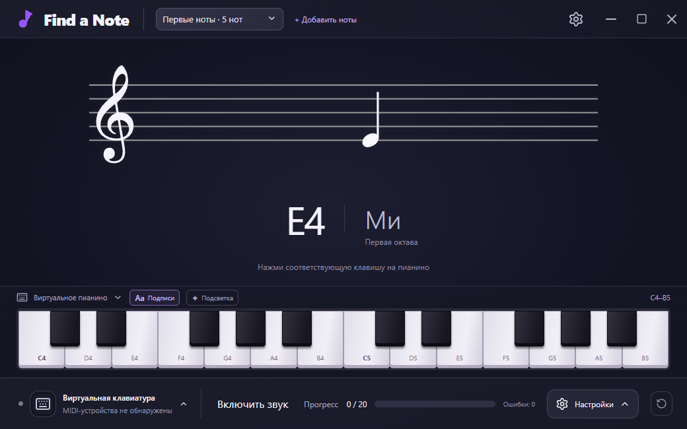
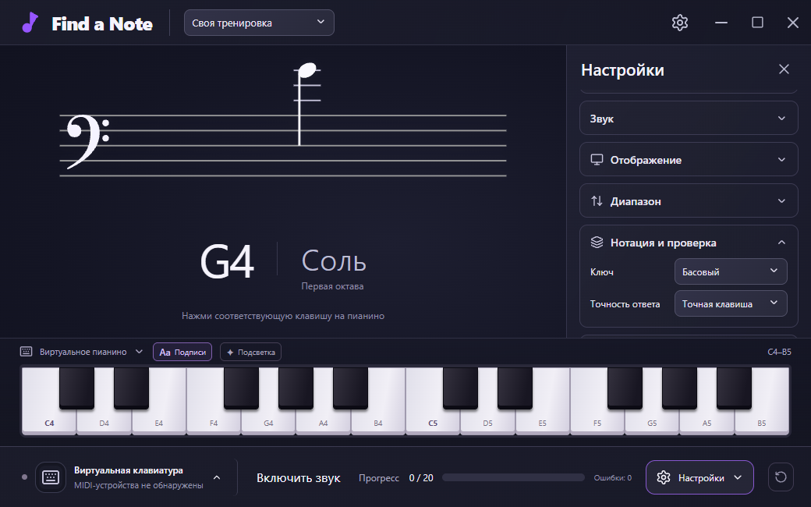

# Find a Note

Find a Note is an open-source piano sight-reading trainer for Windows 10 and 11 (x64) and macOS (Apple Silicon). See a note on the staff and play it on a physical MIDI keyboard or the on-screen piano. Practice and piano playback work offline after installation.

[Official website](https://pembrock.github.io/find-a-note/) · [Download from GitHub Releases](https://github.com/pembrock/find-a-note/releases/latest)





## Features

- Start with five treble-clef notes and expand to seven, or create a custom exercise with your own range, clef, accidentals, and answer rules.
- Practice with the on-screen keyboard or a physical MIDI keyboard via WinMM on Windows or CoreMIDI on macOS. The app supports device selection, automatic reconnection, and per-device range calibration. Yamaha P-45 and SE25 were used in earlier hardware checks.
- Switch between English and Russian in the app.
- Play bundled Salamander Grand Piano samples with adjustable volume and per-input sound controls.
- Save exercise, display, audio, and MIDI preferences locally in the app’s WebView2 profile on Windows or WKWebView profile on macOS.

## Download and install

Get the package for your platform from the [official releases](https://github.com/pembrock/find-a-note/releases). Match the SHA-256 of your download against the release’s `SHA256SUMS.txt`. [Installation guide in English](docs/INSTALL-EN.md) · [Инструкция по установке на русском](docs/INSTALL-RU.md)

- **Windows 10 and 11 x64.** Run the Setup EXE for a per-user installation, or run the Portable EXE directly. Microsoft Edge WebView2 Runtime is required. When missing, the app or installer can prompt for its installation, which needs an internet connection.
- **macOS Apple Silicon.** Open the arm64 DMG, drag **Find a Note** onto **Applications**, eject the image, and open the installed app. Testing covered macOS 27.2.1 on Apple Silicon.

The Mac app uses an ad hoc signature. macOS may block a downloaded copy at first launch. If you trust the source and have verified its SHA-256, try opening the app, then check **System Settings → Privacy & Security → Open Anyway**. The option depends on your Mac’s security policy. [Apple’s guide to opening apps safely](https://support.apple.com/en-us/102445)

## Updates

Use **Settings → About → Check for updates**. Windows downloads and verifies the matching Installer or Portable package and applies it after confirmation.

On macOS, install 0.4.1 manually from the arm64 DMG if you are using 0.4.0. From 0.4.1 onward, the app can download and verify later updates and, when installed in a supported writable location, apply them after you confirm installation and restart. Gatekeeper may require **Open Anyway** for the new copy. See the installation guide for the manual DMG option and recovery. [macOS updater details](docs/macos/MAC-06B-AUTO-UPDATER.md)

## Build from source

Install Go 1.25 or later, Node.js 22 or later, and Wails CLI 2.17.0. Put the Go bin directory on PATH after installing the CLI.

```powershell
go install github.com/wailsapp/wails/v2/cmd/wails@v2.17.0
wails doctor
wails dev
```

For a production application, run `wails build` from the repository root. The executable is `build/bin/Find a Note.exe`. For the Windows installer and Portable EXE, install NSIS 3.x, make sure `makensis` is on PATH, and run `./scripts/build-release.ps1`. That script also embeds third-party license notices and writes SHA-256 checksums. See the [Windows release guide](docs/RELEASE-01.md).

```powershell
cd frontend
npm ci
npm run build
npm test
npm run test:ui
cd ..
go test ./...
go vet ./...
```

The Playwright tests use Microsoft Edge by default and start a local Vite server. The frontend build generates the files required by the Go embed directive. On macOS without Edge, install the pinned browser with `npx playwright install chromium` inside `frontend`, then run `PLAYWRIGHT_BROWSER=chromium npm run test:ui`. `PLAYWRIGHT_BROWSER=webkit` selects the separately installed Playwright WebKit for additional checks; it does not replace native WKWebView validation. See [MAC-03](docs/macos/MAC-03-AUDIO-WEBKIT.md) for results and limitations.

## Local macOS build (Apple Silicon)

With Xcode Command Line Tools and the same Go, Node and Wails prerequisites:

```sh
export PATH="$(go env GOPATH)/bin:$PATH"
wails doctor
(cd frontend && npm ci && npm run build && npm test)
go test ./...
go vet ./...
wails dev
# Quit the development app before building production.
CGO_ENABLED=1 wails build -platform darwin/arm64
```

Open `build/bin/find-a-note.app` in Finder. Both bundle versions follow `wails.json`. For reproducible arm64 DMG packaging with license notices, use the [macOS packaging guide](docs/macos/MAC-04A-DMG-DESIGN.md).

## License and attribution

Copyright (C) 2026 Kirill Pasikuta

The Find a Note project source is licensed under the GNU General Public License, version 3 only (`GPL-3.0-only`). See [LICENSE](LICENSE). Third-party components retain their own licenses.

- Salamander Grand Piano samples by Alexander Holm are licensed under [CC BY 3.0](https://creativecommons.org/licenses/by/3.0/). See the [sample attribution](frontend/public/audio/salamander/ATTRIBUTION.txt) and [license](frontend/public/audio/salamander/LICENSE.txt).
- Tone.js is distributed under the [MIT License](frontend/public/audio/TONE-LICENSE.md). The Windows and macOS packaging scripts bundle notices for the Go and frontend dependencies.
