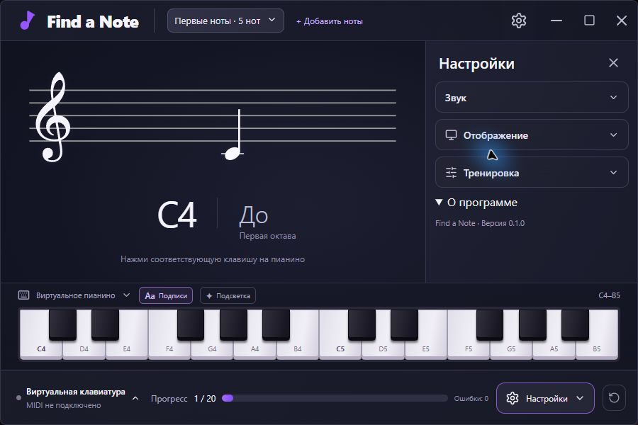

# Find a Note

Find a Note is a desktop sight-reading trainer. See a note on the staff and play it on a physical MIDI keyboard or the on-screen piano. Once Microsoft Edge WebView2 Runtime is installed, practice and piano playback work offline.



## Features

- Start with five treble-clef notes and expand to seven, or create a custom exercise with your own range, clef, accidentals, and answer rules.
- Practice with the on-screen keyboard or a Windows MIDI keyboard via WinMM. The app supports device selection, automatic reconnection, and per-device range calibration. Yamaha P-45 and SE25 were used in earlier hardware checks.
- Play bundled Salamander Grand Piano samples with adjustable volume and per-input sound controls.
- Save exercise, display, audio, and MIDI preferences locally in the app’s WebView2 profile.

## Platform and stack

The current target is **Windows 10 or 11, x64**, with Microsoft Edge WebView2 Runtime. macOS is planned. The app uses Go and Wails v2 for the desktop shell, React and TypeScript for the interface, VexFlow for notation, Tone.js and Web Audio for playback, and WinMM for native MIDI input.

## Build from source

Install Go 1.25 or later, Node.js 22 or later, and Wails CLI 2.17.0. Put the Go bin directory on PATH after installing the CLI.

```powershell
go install github.com/wailsapp/wails/v2/cmd/wails@v2.17.0
wails doctor
wails dev
```

For a production application, run `wails build` from the repository root. The executable is `build/bin/Find a Note.exe`. For the Windows installer and Portable EXE, install NSIS 3.x, make sure `makensis` is on PATH, and run `./scripts/build-release.ps1`. That script also embeds third-party license notices and writes SHA-256 checksums. See the [Windows release guide](docs/RELEASE-01.md).

```powershell
cd frontend
npm ci
npm run build
npm test
npm run test:ui
cd ..
go test ./...
go vet ./...
```

The Playwright tests use Microsoft Edge and start a local Vite server. The frontend build generates the files required by the Go embed directive.

## License and attribution

Copyright (C) 2026 Kirill Pasikuta

The Find a Note project source is licensed under the GNU General Public License, version 3 only (`GPL-3.0-only`). See [LICENSE](LICENSE). Third-party components retain their own licenses.

- Salamander Grand Piano samples by Alexander Holm are licensed under [CC BY 3.0](https://creativecommons.org/licenses/by/3.0/). See the [sample attribution](frontend/public/audio/salamander/ATTRIBUTION.txt) and [license](frontend/public/audio/salamander/LICENSE.txt).
- Tone.js is distributed under the [MIT License](frontend/public/audio/TONE-LICENSE.md). The Windows packaging script embeds the license notices collected from the bundled Go and frontend dependencies.
